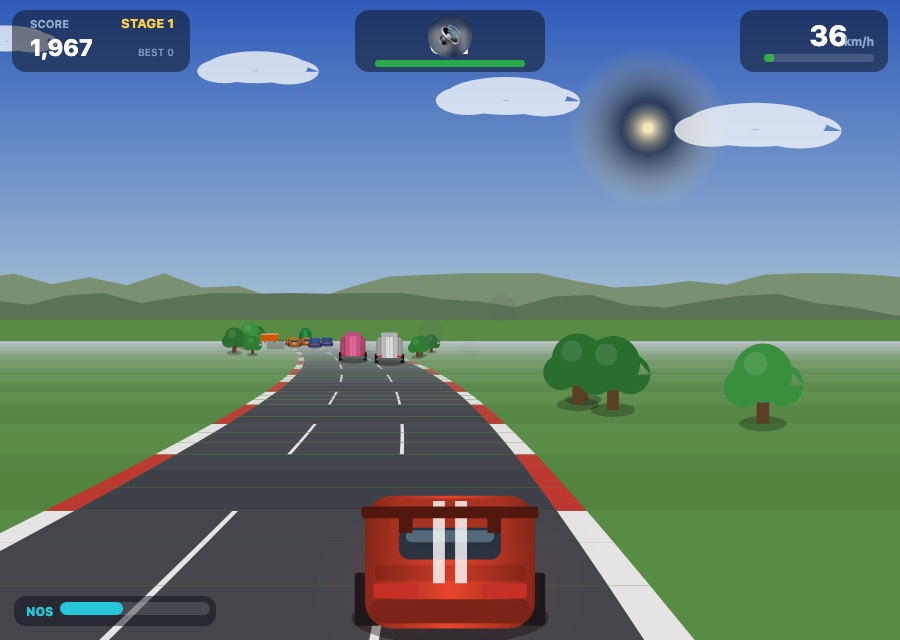
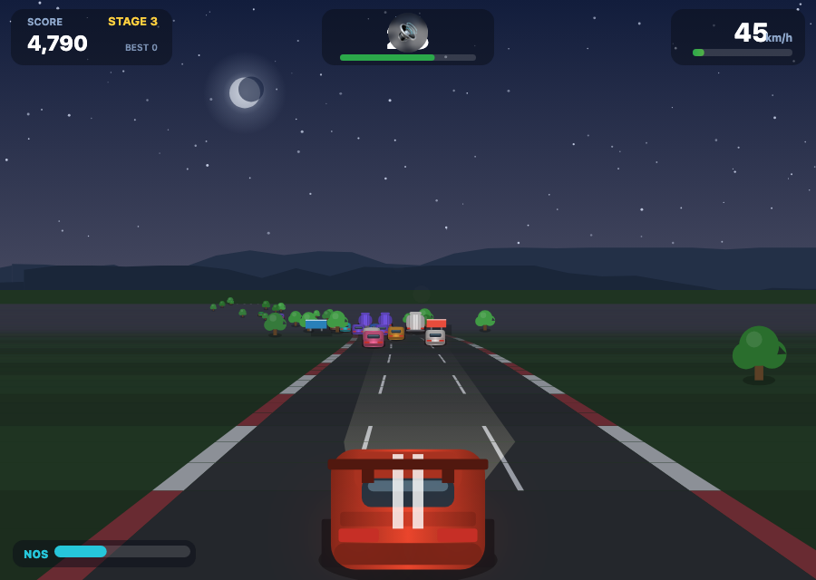

# 🏎️ TURBO RACER · 极速狂飙 v2.0

<p align="center">
  
  
</p>

街机级伪 3D 赛车游戏 —— 纯原生 Canvas + WebAudio，**零依赖、零构建，打开即玩**。

## 🚀 运行

```bash
cd turbo-racer
python3 -m http.server 8080     # 或直接双击 index.html
```

生产部署（Docker 一行上线）：
```bash
docker run -d --name turbo-racer -p 8080:80 -v "$PWD":/usr/share/nginx/html:ro nginx:alpine
```

## 🎮 玩法

| 按键 | 功能 |
| --- | --- |
| `← →` / `A D` | 转向 |
| `↑` / `W` | 油门 |
| `↓` / `S` | 刹车 |
| `Shift` | 释放 NOS 氮气 |
| `P` / `Esc` | 暂停 · `M` 静音 · `Enter` 开始/重开 |

📱 移动端：按住屏幕左右半边转向（自动油门），右下角 NOS 按钮释放氮气。

**街机规则：**
- ⏱ **时间耗尽即结束** —— 冲过检查点龙门才能续命，越往后奖励越少
- 🏔 弯道带**离心力**，高速过弯会被甩出路面，入弯必须刹车
- 🔥 **贴身超车**触发连击加分，同时为 NOS 充能；跟在前车后面可**吸尾流**充能
- 💥 撞车不会死：旋转失控 + 时间照走，代价是致命的几秒钟
- 🌙 每关一个主题：正午高速 → 落日大道 → **午夜疾驰**（车头灯照亮路面）→ 黎明海岸

## ✨ 技术特性

- **分段式伪 3D 赛道引擎**：程序化生成无尽赛道（弯道 / S 弯 / 坡道 / 丘陵），透视投影 + 山体遮挡裁剪 + 距离雾
- **昼夜主题系统**：四套调色板随关卡进度连续插值，夜星空 + 月亮 + 车头灯体积光锥
- **AI 车流**：轿车 / 卡车混合，跟车减速、主动变道，难度随关卡爬升
- **WebAudio 全程序化合成**：五挡循环声浪、氮气啸声、超车呼啸、检查点音阶、撞击爆炸（零音频文件）
- **粒子系统**、屏幕震动、撞车慢动作、速度线
- 窗口化赛道内存管理、高 DPI、触屏适配、后台自动暂停、本地最高分

## 📁 结构

```
turbo-racer/
├── index.html    # 页面骨架 + UI 覆盖层
├── style.css     # 玻璃拟态 UI
├── game.js       # 引擎与玩法全部逻辑
├── screenshots/  # 实机截图
└── README.md
```
